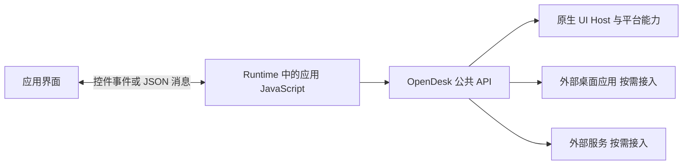

# JavaScript 桌面应用解决方案

OpenDesk 应用由 JavaScript、界面资源和应用配置组成，复用已安装 Runtime 的窗口、文件、网络与桌面自动化能力。应用可以作为脚本运行，也可以通过 App Mode 获得稳定身份、主窗口、单实例和退出生命周期，最终携带预编译 Runtime 交付为独立桌面应用。

独立应用是运行和交付形态，基于框架是实现关系，两者可以同时成立。普通应用开发者无需编写 Go 或重新构建 OpenDesk；只有现有公共能力无法满足需求、且能力应由底层统一拥有时，才进入 Runtime 扩展路线。

本方案面向需要创建自己界面的应用作者，串联现有 Custom UI、App Mode 与 App Builder。面向外部软件的界面分析、定位和动作开发，继续使用[应用自动化开发框架](app-development-framework.md)。公开签名、参数、权限和平台支持以对应 [API 文档](../api/README.md) 为准。

## 适用范围与运行形态

| 需求 | 采用的形态 | 主要职责 |
| --- | --- | --- |
| 一次任务、短时工具或临时操作面板 | 普通 JavaScript execution，按需创建 Custom UI | 脚本组织任务并处理自身窗口的生命周期 |
| 有主窗口、稳定身份和应用级生命周期的桌面工具 | JavaScript App Mode package | App Shell 管理应用生命周期，JS 负责界面和业务 |
| 面向用户的可搬移桌面应用 | App Mode package 加预编译 Runtime，由 App Builder 组装 | 保持 JS 编程模型，增加桌面发行产物 |

外部桌面应用和外部服务都是可选依赖。纯本地数据工具不需要为了采用本方案而创建测试聊天、HTTP 服务、Recorder 或新的 Workflow Runtime。这里的“应用扩展”也不等同于 Manifest Native Extension；后者是接入外部原生能力的另一种机制，见 [Runtime API 扩展与定制框架](runtime-api-extension-framework.md)。

## 应用与框架的职责



图表示职责与数据流，不规定固定进程数量。窗口由平台宿主承载，业务仍可以由 JS 实现；出现原生 helper 或独立可执行文件，并不能据此判断业务写在 Go 中。具体进程所有权见[桌面启动契约](../architecture/app-mode-desktop-launch.md)。

| 部分 | 应拥有的内容 | 维护位置 |
| --- | --- | --- |
| 领域逻辑与业务状态 | 业务数据、规则、状态转换和结果解释 | 应用自己的 JS 或 TypeScript 模块 |
| 应用界面 | 页面、表单、展示、编辑和用户操作入口 | 应用自己的界面源码与构建资源 |
| 应用侧控制逻辑 | 创建窗口、处理事件或消息、调用公共 API、清理监听与任务 | Runtime 中执行的应用 JS |
| 应用适配器 | 具体软件的解析、定位约定，或具体服务的数据格式转换 | 应用模块；形成跨项目复用后再提取 helper |
| OpenDesk Runtime 与原生 UI Host | 通用 API、平台驱动、资源和 execution 生命周期 | 框架 native owner 与对应公共契约 |
| 独立测试对象 | 提供可控的外部窗口、数据或服务行为 | 所属测试域的工具和 fixture |

“应用侧 Host”如果只是处理窗口消息的 JS 模块，仍属于应用代码；它与框架提供的原生 `ui-host` 是不同职责。文件名、模块名和进程名不能替代这一划分。

业务状态应按数据种类确定唯一权威来源，可以按领域拆分模块。页面、控制脚本和适配器只同步各自需要的投影，避免各自维护一份可独立修改的业务状态。窗口身份、授权与动作凭据则由实际执行动作的一侧核验，不能因页面显示“已连接”就视为有效。

## 选择界面能力

| 界面需求 | 当前入口 | 开发边界 |
| --- | --- | --- |
| 紧凑的原生工具栏或浮动控件 | `FloatingWindow` | 使用其公开控件和更新方法 |
| 受限 HTML 和 CSS 表单或面板 | `ui.createWindow()` | 业务 JS 在外层 Runtime listener 中执行，页面不运行任意业务脚本 |
| 需要 React 等页面脚本的本地应用界面 | `ui.createTrustedWindow()` | 加载自包含 HTML 和固定 SHA-256，通过 JSON 消息桥交互；当前仅支持 macOS 11+ 与匹配的原生 host |

React 是应用可以选择的界面技术，不是 App Mode 的前置条件。Trusted Window 的平台支持也不能从 App Mode 或普通窗口的支持情况推导；计划交付 Windows 或 Linux 时，先按 [Custom UI](../api/ui.md) 核对所选 surface 的可用性，再决定实现范围。

Trusted Window 中有两种 JS 环境：页面 JS 负责 DOM 与页面状态，Runtime JS 负责调用 OpenDesk API。页面不拥有 `File`、`Runtime`、`ui` 或桌面自动化全局，通过 `OpenDeskApp` 的 JSON 桥与外层脚本交互。固定内容摘要用于核对加载的页面字节，不授予页面桌面操作权限。

可信页面当前要求脚本与样式内联打包，不加载相邻资源或远程页面，且禁止下载与任意网络连接。文件选择、备份、服务调用等需求应分别核对可用 API，并由应用定义必要的受限交互；不能直接假定普通浏览器中的功能在原生窗口内可用。详细限制见 [ui.createTrustedWindow](../api/ui.md#uicreatetrustedwindowspec)。

## 组织应用源码和交付资源

下面是职责示意，目录名可随项目调整；它不是另一个 Manifest 格式或可直接运行的样板：

```text
my-app/
├── opendesk.app.json          应用身份、入口和生命周期配置
├── main.js                    Runtime JS 入口
├── modules/                   业务模块、控制逻辑与适配器
├── src/                       可选的界面源代码与构建输入
└── ui/                        Runtime 实际加载的界面和发布资源
```

应用直接维护源代码，构建过程生成发布资源；不要同时手改生成 HTML 或保留两套业务页面。发布包只包含实际运行需要的入口、模块、Manifest 和资源，完整依赖仍按当前 package 校验与 staging 规则确定。构建工具需要 Node.js，并不意味着最终应用要额外启动一个 Node 服务。

App Mode 的 `entry` 指向 JS 入口；声明 `window.mainId` 时，应与脚本创建的主窗口 ID 对应。其他字段、路径规则和兼容性统一查阅 [App Package Format](../architecture/app-package-format.md)，不为某个应用发明新的 Manifest 字段。

业务持久化需要应用单独定义保存范围、位置、版本、失败处理与恢复方式。页面存在状态不等于退出后仍能恢复，文件导出也不等于活动工作区已保存。仓库开发中的日志、截图和 smoke 输出放在 `.runtime/`；需要长期保管的用户数据应有明确的存储和备份策略，不能把可清理运行目录当作永久归档保证。

## 界面与执行的交互边界

普通窗口使用控件事件和 handle 更新界面；Trusted Window 使用双向 JSON 消息。桥只负责数据传输，消息名称和业务字段属于应用协议，不会自动成为 OpenDesk 公共 API。

应用侧控制逻辑按以下顺序处理可能产生副作用的请求：

1. 校验消息类型、字段、数据大小和当前应用状态，只接受已定义的动作。
2. 在执行侧核对授权、目标身份和必要的前置条件；握手、选中一条记录或收到模型结果都不能替代这些条件。
3. 对异步请求绑定当前对象和状态版本，拒绝已经过期或重复的请求。
4. 调用公开 API 后，按业务目标独立读取结果；区分请求已接收、动作已发生、结果已确认与结果未知。
5. 窗口关闭、任务取消或授权撤销后，使旧请求失效并清理当前应用拥有的资源。

外部数据和页面消息按数据处理，不提供任意 JS、shell 或文件路径执行通道。动作可能已经发生而回执未知时，先读取现场再决定后续处理，不能直接重复前缀。具体桌面定位与修复方法见 [UI 定位代码生成与失败修复](ui-locator-repair.md)。纯展示应用不需要额外建立桌面动作授权流程。

模型、检索、企业 API 或已有服务可通过应用适配器接入。需要独立服务进程时，应用应说明启动、配置、故障和数据传输边界；这种依赖不应因某个业务示例使用了它，就成为所有 OpenDesk 应用的必需组件。扩展层级仍按 [Runtime API 扩展与定制框架](runtime-api-extension-framework.md)选择。

## 从开发到桌面交付

1. **确定运行形态和界面能力。** 短任务可以保留脚本入口；有应用级生命周期时使用 App Mode，同时核对所需平台与 surface。
2. **实现业务与交互。** 先建立领域状态、界面和必要适配器，再接入 Runtime 调用；每类状态有明确 owner。
3. **组织 App package。** 编写 Manifest 和 JS 入口，按 [Script App Packaging](../api/script-app-packaging.md) 完成静态校验、诊断和开发态启动。最小可运行结构见 [App Mode 示例](../../examples/app-mode/README.md)。
4. **验证真实加载和功能。** 核对入口、生成资源、Runtime 与 UI host 来源，再检查实窗和业务结果。源码目录运行与安装后的桌面产物分别验收。
5. **组装发行产物。** 使用同平台已安装的完整 Runtime 或 SDK，按 [Installed Runtime App Builder](../api/app-builder.md) 生成 macOS `.app` 或 Windows portable directory；再按发行要求完成签名、系统启动与搬移验证。

App Builder 复用预编译 Runtime 并放入 App package，不将业务 JS 编译成 Go，也不执行应用业务。Builder 成功不能替代功能验收或签名、公证等发行资格。Trusted Window 目前的平台范围仍限制采用它的应用，不能因 Builder 有 Windows 目标就宣称该页面可在 Windows 运行。

框架维护者修改底层实现或内置资源时，应按依赖关系刷新受影响的 Runtime、host 或发行包，并重新核对契约与证据。普通应用开发不以 checkout OpenDesk 源码、执行 `go build` 或修改官方产品外壳为前置条件。

## 分层验证与证据

| 验证层 | 要证明的内容 | 不能据此推出的结论 |
| --- | --- | --- |
| 业务模块测试 | 规则、状态转换、数据隔离和失败处理正确 | 原生窗口已经加载或桌面动作已经成功 |
| 页面或浏览器验证 | 界面交互、布局和前端状态符合预期 | 原生消息桥、系统权限或真实目标可用 |
| Runtime 与实窗集成 | 当前入口、页面资源和匹配 host 实际加载，消息与清理有效 | 业务最终结果或安装包发行资格已通过 |
| 独立目标验证 | 对受控外部应用或服务的观察、动作和结果读取成立 | 真实生产软件、账号和业务数据已获验证 |
| 发行产物验证 | 搬移、单实例、退出、签名与目标系统启动符合交付要求 | 未验收的目标平台或真实业务已经可用 |

实窗验收同时检查可见内容、窗口尺寸、裁切、对齐与功能结果，分别记录代码已修改、实际已加载、视觉已确认和功能已验证。独立测试目标能帮助证明跨应用交互，但不是每个应用的运行依赖；它的实现语言也不决定被测应用的实现语言。

验证范围与状态保存在所属质量记录中，运行证据写入 `.runtime/`。通用方案保留验证方法和证据边界，不复制某次运行的通过结论。成熟度要求见[能力开发与成熟度路径](capability-development.md)。

## 示例一 AI 客服助手

[AI 客服助手](../../examples/ai-customer-support/README.md)是本方案的第一个业务示例。它展示 JS 应用、React 页面、桌面适配器与独立测试目标的组合；客服页面、数据规则和消息协议仍由该项目维护，不作为通用框架的必需模块。

| 通用职责 | 示例中的对应实现 |
| --- | --- |
| 当前原生启动器 | [scripts/run-desktop.sh](../../examples/ai-customer-support/scripts/run-desktop.sh)，启动独立聊天与六页助手 |
| Runtime 中的应用侧控制逻辑 | [native-demo.js](../../examples/ai-customer-support/native-demo.js)，创建可信窗口并处理受限消息 |
| 界面与业务状态 | [src/main.tsx](../../examples/ai-customer-support/src/main.tsx)、[src/state.tsx](../../examples/ai-customer-support/src/state.tsx) 与 `src/domain/` |
| 正式页面资源 | [preview/index.html](../../examples/ai-customer-support/preview/index.html)，从正式源码生成并按摘要加载 |
| 外部桌面交互 | [native-demo.js](../../examples/ai-customer-support/native-demo.js) 与 [desktop/native-adapter.js](../../examples/ai-customer-support/desktop/native-adapter.js) |
| 可选外部服务适配 | [desktop/query-api-adapter.js](../../examples/ai-customer-support/desktop/query-api-adapter.js)，由原生 Demo 在显式配置后使用 |
| 独立测试目标 | [SupportChat Swift 源码](../../tests/custom-ui/tools/support-chat/main.swift)，独立的 AppKit 测试聊天客户端 |

示例有不同运行方式，具体命令统一维护在其 README：

- **历史独立 App Mode** 已按用户纠偏退役，Manifest、入口与 Host 均已移除；它没有聊天 provider，不能代替当前原生 Demo。[退役记录](../quality/ai-customer-support-ui-retirement-20261030.md)保留范围与恢复提交。本方案对通用 App Mode 的说明仍适用其他应用。
- **原生 Demo** 从 `native-demo.js` 启动，针对启动器创建的独立测试聊天观察消息、处理建议并填入草稿；通过新的原生读取验证草稿结果。测试目标没有真实发送动作。
- **浏览器预览** 使用相同构建 HTML 展示页面及模拟交互，用于前端验证，不代替原生桥和桌面自动化验收。

独立 `OpenDeskSupportChat.app` 使用 Swift，是供自动化读取和操作的测试对象。客服助手应用本身仍使用 JS、TypeScript 和 React，复用 OpenDesk Runtime；桌面发行包携带 Go Runtime 不会改变这一归属。

当前示例采用 Trusted Window，原生界面范围为 macOS；真实平台连接、业务资格与各项验证状态以[示例 README](../../examples/ai-customer-support/README.md)、[应用设计](../../examples/ai-customer-support/DESIGN.md)及其链接的质量记录为准。后续应用复用本方案的职责划分和开发步骤，再选择自己的界面、业务状态、适配器与测试目标，不需要复制客服模型或测试聊天。

## 文档维护边界

| 内容 | 唯一维护位置 |
| --- | --- |
| JS 桌面应用的通用组合方案与职责划分 | 本文 |
| 窗口、消息、生命周期、打包的公开契约 | [Custom UI](../api/ui.md)、[App Mode 与 App Shell](../api/app-shell.md)、[Script App Packaging](../api/script-app-packaging.md)及其引用的 Reference |
| 应用业务需求、数据和协议、具体启动命令 | 对应项目的 README、设计与集成文档 |
| 验收范围、运行结果和证据 | 所属 `docs/quality/` 文档；本地运行产物在 `.runtime/` |

新增业务示例时，在本方案登记职责映射与项目入口；完整业务正文留在项目中。遇到框架能力变化时，先更新对应 API 和实现契约，再调整本方案的选择说明，避免形成第二套接口定义。
