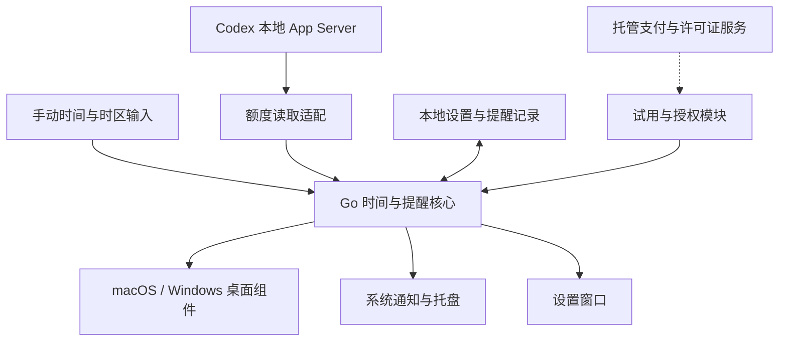

# Desktop Reset Clock：桌面重置提醒应用方案

- 状态：**PROPOSED / 待用户确认**
- 创建与外部资料核查日期：2026-10-11
- 目标平台：macOS、Windows
- 推荐宿主仓库：OpenDesk；核查默认分支为 `master`
- 源码核查基线：`9615110725e514b6f607740174cbf7b427654ff9`
- 本次交付：设计文档与 demo 目录说明。**没有应用源码、可运行程序、安装包或运行验收结果。**
- 对应入口：[examples/desktop-reset-clock/README.md](../../examples/desktop-reset-clock/README.md)

## 1. 用户要求与本轮边界

用户希望开发一个主要使用 Go 的 macOS / Windows 桌面应用，显示当前时间、计算时差、提醒 Codex 用量重置，并显示在系统桌面背景中。提出的价格目标为每人 0.99/月、首次免费，考虑先作为现有仓库中的 demo。用户明确要求先给整体方案、框架与文档驱动推进步骤，确认后再写代码。

本方案保留上述目标。以下仍是建议，不能当作用户已经批准的产品规则：

- “0.99”的币种尚未确定；商业算例暂按 USD。
- “首次免费”建议定义为首次 30 天完整试用，无需绑卡、不会自动扣费。
- 结算建议从年度使用授权开始：US$11.88/年，等效 US$0.99/月；这与每月实际扣 US$0.99 有区别，需用户确认。
- 一人两台活跃设备，Mac / Windows 通用。
- Go 为主要语言；平台窗口适配允许少量 Objective-C / Win32 调用。
- 框架先做可行性验证，再固定经过验证的版本。

本次只新增本文件及 demo README，不创建 Go module、不安装依赖、不运行桌面、不接入真实支付。

## 2. 产品定位与首版范围

建议工作名称为 **Reset Clock**，代码目录使用 `desktop-reset-clock`。产品价值是“可靠获知下一次可用时间，并在需要时提醒”，当前时间和时区换算服务于这个目标。

首版收费价值应来自真实额度读取、重置事件维护、提醒可靠性与双平台兼容维护。只有手工设置倒计时的 demo，还不足以证明用户会持续订阅。首先面向已经使用 Codex 的个人开发者验证需求。

### 2.1 首版范围

| 能力 | 建议行为 |
|---|---|
| 当前时间 | 使用系统本地时区，支持 12/24 小时；默认显示到分钟，秒显示可选 |
| Codex 重置 | 展示当前账户实际返回的额度窗口、预计重置时刻和倒计时 |
| 数据来源 | 显示自动读取 / 手动设置，以及最近更新时间；缓存过期有明确状态 |
| 手动设置 | 未安装或暂时无法连接 Codex 时仍可设置绝对时刻或“多久后”；始终标明手动 |
| 时差计算 | 输入日期、时间和来源时区，转换为本地及所选时区；显示跨日和 UTC 偏移 |
| 提醒 | 默认到时一次；可选提前 10 分钟和稍后提醒；支持免打扰 |
| 桌面显示 | 普通应用可遮住组件，组件不抢焦点，锁定后点击穿透 |
| 托盘 / 菜单栏 | 显示下一次重置、刷新、设置、编辑位置、隐藏组件、退出 |
| 持久化 | 保存设置、必要缓存与提醒去重状态；重启后恢复 |
| 常驻体验 | 单实例；关闭设置窗口继续运行；开机启动由用户选择 |
| 首版商业能力 | 完整试用、购买 / 恢复授权、两设备激活、到期与离线状态 |

先支持一个当前 Codex 账户及该账户实际返回的多个额度窗口。多账户、其他 AI 产品、云同步、团队席位、远程控制、动态壁纸市场和插件市场不进入首个 demo。

### 2.2 界面结构

桌面组件采用紧凑布局：第一行当前时间，第二行最相关额度的倒计时，第三行本地重置时刻。数据不新鲜时用短状态替代误导性正常展示。详细额度与时区列表在托盘展开页或设置窗口查看。

设置窗口只保留三个区域：

1. **时间与提醒**：Codex 连接、手动时间、时区、提前提醒、免打扰。
2. **桌面显示**：显示器、字号、浅深色、位置、锁定、显示秒、显示 / 隐藏。
3. **授权与关于**：试用剩余、购买或恢复、设备与到期信息、更新和诊断。

正常显示时不塞进 RPC、UTC 存储格式、框架版本等工程信息。完整诊断留在用户主动打开的诊断页面。

“预计重置时间已到”与“服务端确认额度可用”是不同状态。程序不能仅因为本地倒计时归零，就承诺 Codex 已恢复可用。

## 3. 已有仓库能力与复用边界

以下是源码核查事实，不是本产品已实现的能力。

| 已有内容 | 核查结果 | 本产品的复用方式 |
|---|---|---|
| `pkg/appshell/` | 已有 macOS / Windows 平台文件、托盘和生命周期逻辑 | 参考平台约束、单实例与退出设计；审计依赖后复用可独立部分 |
| `examples/app-mode/` | 现有示例采用 OpenDesk Runtime + JavaScript App Mode package | 它是另一种开发入口，不能冒充独立 Go 小应用 |
| `internal/browserai/process.go` | 已有 Codex App Server 受控子进程和 RPC 白名单；当前没有 `account/rateLimits/read` | 参考初始化、超时、错误与进程清理；单独建立范围有限的额度读取适配 |
| 根 `go.mod` | 使用 Go，包含 RobotGo、GoCV、Goja 等运行时依赖 | 小工具使用独立 module，不默认加载整套自动化 Runtime |
| 现有包授权 | 属于 OpenDesk 受保护脚本包等特定领域 | 不能直接等同于本产品订阅 / 年度使用权益 |
| 桌面背景模式 | 本轮没有找到可直接证明本产品所需行为已完成的证据 | macOS / Windows 都需要新的实际窗口验证 |

核查基线：

- [App Shell 原生入口](https://github.com/shopable-ai/opendesk/blob/9615110725e514b6f607740174cbf7b427654ff9/pkg/appshell/native.go)
- [Codex 适配代码](https://github.com/shopable-ai/opendesk/blob/9615110725e514b6f607740174cbf7b427654ff9/internal/browserai/process.go)
- [根 go.mod](https://github.com/shopable-ai/opendesk/blob/9615110725e514b6f607740174cbf7b427654ff9/go.mod)

现有 Codex 适配还把经过审计的版本限定为 `codex-cli 0.159.2`。新应用不能从“官方当前文档已有方法”直接推出“现有本地版本已支持且已验收”。必须记录新适配实际支持的 Codex 版本、账户模式和返回格式。

本 demo 不扩大 Browser 工作流的 RPC 权限，也不把它作为后台常驻时钟的宿主。

## 4. Codex 数据来源与正确性

### 4.1 已确认的官方能力

官方 App Server 文档公开了 `account/rateLimits/read`、`account/rateLimits/updated`，以及 `resetsAt`、`windowDurationMins` 等字段。`resetsAt` 是 Unix 秒；返回可以包含多个额度桶，部分窗口可以为空。[来源：Codex App Server](https://learn.chatgpt.com/docs/app-server)

当前官方定价文档说明：Plus / Standard Business 的估算使用五小时周期，Pro 当前没有五小时限制，周限制可能适用；应以账户的用量面板为准。因此不能把所有账户硬编码成“五小时 + 一周”。[来源：Pricing](https://learn.chatgpt.com/docs/pricing)

### 4.2 推荐读取路径

由桌面应用通过受控本地 Codex App Server 读取额度，优先使用 Codex 自己管理的现有登录。连接入口须让用户明确知道读取的是哪一个本地账户。

- 首先检测受支持的本地 Codex 可执行文件与版本。
- 使用官方初始化和账户读取流程，再读取额度。
- 本产品适配层只开放初始化、账户识别和额度读取所需的方法。
- 不创建模型任务来“探测额度”，也不调用消费重置权益、购买额度或运行自动化任务的方法。
- ChatGPT 登录与 API-key-only 是不同模式；不把通用 API RPM/TPM 当成 Codex 套餐重置。
- 认证信息交给官方客户端管理；本应用不上传 OpenAI 凭证、会话或代码到自己的收费服务器。
- demo 优先要求本地已有受支持的 Codex CLI。正式发行前实测普通用户安装与连接流程；不静默安装或捆绑未经评估的客户端。

官方有更新事件，但独立 App Server 进程未必即时获知另一台设备或另一客户端的全部使用变化。需要低频重读与失效策略，不把事件通知当成全球实时推送保证。

### 4.3 刷新与失效策略（设计默认值）

| 场景 | 处理 |
|---|---|
| 启动 / 用户点击刷新 | 立即读取一次；合并并发请求 |
| 正常运行 | 每 5 分钟重读一次；观察到可用更新事件则应用最新快照 |
| 距已知重置不足 15 分钟 | 可提高至每分钟一次；不会每秒联网 |
| 到达重置时刻 | 尝试刷新；先显示“预计重置时间已到”，再按新快照更新 |
| 网络错误 / 429 | 超时、退避、抖动；遵循服务端重试提示 |
| 休眠恢复 / 网络恢复 | 先重算本地时间，合并触发一次刷新 |
| 账户切换 | 清理旧账户的待提醒计划；忽略旧请求迟到响应 |
| 字段缺失 / 版本不支持 | 显示未知 / 暂不支持并保留手动入口 |

缓存过期与临时离线不能显示成“零使用量”。只读请求也需要验证进程启动成本、请求频率与服务端行为。若独立常驻 App Server 成本过高，在可行性阶段比较短连接读取和长连接复用，再作决定。

### 4.4 数据契约

下面是拟定的内部数据概念，不是已经发布的 OpenDesk API：

| 概念 | 规则 |
|---|---|
| 账户标识 | 用于隔离当前账户；默认 UI 仅显示必要的脱敏识别信息 |
| 额度标识 | 保留实际 `limitId` 与窗口角色，不依赖“primary 必为五小时” |
| 目标时刻 | 单一 UTC 绝对时间；边界层明确秒 / 毫秒单位 |
| 窗口长度 | 来自实际数据；未知就保持未知 |
| 来源 | 自动、手动或缓存；展示状态由明确规则产生 |
| 观察时刻 | 记录最后成功读取时间，支持新鲜度判断 |
| 使用量 | 单独区分服务端已用百分比与 UI 剩余百分比 |
| 修订 / 请求代次 | 防止并发与账户切换后的旧响应覆盖新状态 |
| 提醒标识 | 账户、额度窗口、目标时刻、提前量构成可持久化去重标识 |

手动输入与自动来源分别保存。用户切回自动模式时，不把旧的手工目标误当作服务端返回值。

## 5. 时间、时区与提醒规则

Go 核心统一处理时间。UI 只消费显示模型，不由 JavaScript 的定时递减承担正确性。

- 使用 UTC 绝对时刻存储重置目标；额外保存用户选择的 IANA 时区名称。
- 使用 `time.LoadLocation` 做时区转换，并由应用入口包含 `time/tzdata` 作为可用数据源。
- 时差基于目标日期计算，不能把洛杉矶与上海的差固定成某个小时数。
- 手动输入必须同时含日期、时间、时区；跨日明确显示日期。
- 遇到夏令时导致的重复或不存在的当地时间，给出可理解的选择 / 错误，不悄悄转换。
- 每次刷新从绝对目标重算剩余时间，不依赖“每秒减一”累计。
- Go 的单调时间适合测量进程内间隔；休眠、系统改时、重启后重新以当前绝对时间核对。不能假定所有系统的单调时钟都计入休眠。
- 到时通知每个逻辑事件最多一次。提前量修改、账户切换和目标变化取消旧计划。
- 休眠错过多个提醒时，唤醒后只补一条仍有意义的通知，不连续弹出历史提醒。
- 通知状态区分请求已提交、已知权限拒绝和 API 返回错误；系统未提供可靠回执时，将投递 / 展示结果标为未知。免打扰可能影响显示，不能从提交成功推断用户已经看到。
- 应用退出或设备关闭后不承诺仍能即时提醒；首版以应用常驻为前提，说明退出与关设置窗口的区别。
- 倒计时显示、系统通知触发与实际投递分别验收。

Go 的时钟与时区行为依据：[time](https://pkg.go.dev/time)、[time/tzdata](https://pkg.go.dev/time/tzdata)。

## 6. 整体技术框架

### 6.1 模块职责

| 模块 | 负责内容 | 边界 |
|---|---|---|
| 时间与状态核心 | UTC / 时区、窗口快照、状态、去重、调度 | 不依赖 GUI 框架，不包含支付商 SDK |
| Codex 适配 | 检测、初始化、额度读取、错误与版本适配 | 不暴露任意 RPC，不执行模型任务 |
| 桌面呈现适配 | 原生窗口、层级、点击穿透、屏幕、绘制与回收 | 不重复实现时间和收费规则 |
| 设置 UI | 配置、连接、展示与授权管理 | 只通过明确的 Go 服务接口操作 |
| 本地存储 | 设置、少量缓存、通知去重、必要版本迁移 | demo 使用小型文件原子写入，不引入数据库服务 |
| 权益适配 | 试用、付费状态、到期与离线缓存 | Demo 可替换为模拟状态；正式版不能以跳转成功页作为付款证明 |

少量配置使用用户配置目录与版本化 JSON；保存变更时原子写入，不每秒落盘。敏感许可证存于系统安全存储或受保护的用户数据文件，日志不包含完整授权码。配置损坏保留备份并提示恢复。demo 不需要 Redis、消息队列、云任务调度或全天联网计时服务。

### 6.2 GUI 框架建议

**首选验证：Go + Wails v3 设置窗口 / 应用壳 + 原生桌面时钟卡片。**

Wails v3 当前为 Beta，桌面 API 已稳定，但并非 GA；v2 仍是稳定版本。v3 的托盘、多窗口和生命周期能力适合新 demo，可在技术验证通过后固定版本；不把 Beta 写成“生产风险已消除”。如果已有成熟可独立复用的壳，应先比较复用成本。[来源：Wails FAQ](https://v3.wails.io/faq/)

设置 UI 用简单 HTML/CSS/TypeScript 即可，不必为了三个设置区域引入大型组件系统。Go 是业务与常驻核心；Node 若使用，仅服务开发构建，不要求最终用户安装 Node。

备选为 Fyne + 原生适配，适合进一步坚持 Go 编写全部普通 UI 的情况。无论选哪个框架，桌面层级都仍需按平台验证。此时不同时实现两套 GUI。

macOS 允许少量 `.m` / `.h` 与 Go 桥接；Windows 使用 Go 调用 Win32 及绘制接口。原生窗口创建、更新和销毁必须归属于确定的主线程 / 事件循环，不能让框架与自建窗口各管一套生命周期。

## 7. 桌面背景模式是首个技术门槛

### 7.1 验收定义

主模式必须达到：

1. 返回系统桌面能看到当前时间与倒计时。
2. 普通应用窗口可以遮住时钟。
3. 默认不抢键盘焦点，不占据普通任务切换入口。
4. 锁定时不阻挡下面的桌面图标点击。
5. 通过托盘进入编辑状态后可拖动，再锁定恢复点击穿透。
6. 屏幕断开后自动回到可见区域。
7. 恢复失败时明确显示当前为兼容小窗口，而不是冒充桌面模式成功。

主体验定位为“壁纸之上的桌面组件”。不通过每秒改写壁纸图片来模拟时钟。首版不承诺所有系统版本、桌面管理器、全屏工作区和动态壁纸软件组合。

### 7.2 macOS

优先用公开 AppKit / CoreGraphics 窗口层级、无边框原生窗口和文本绘制来验证桌面组件。候选能力包括 `NSWindow`、桌面窗口层级和 `ignoresMouseEvents`。具体层级仍需在 Finder、显示桌面、Spaces、Stage Manager、Retina 和全屏场景验证，不能仅凭 API 存在判定通过。

Wails 官方明确指出 macOS WKWebView 的真正透明背景目前依赖 `private_mac_apis`；透明 CSS 不足以实现透明 WebView。因此，桌面上的几行时钟文本建议原生绘制，设置窗口使用普通不透明 WebView。[来源：Wails Private macOS APIs](https://v3.wails.io/guides/build/private-macos-apis/)

### 7.3 Windows

官方 `IDesktopWallpaper` 管理壁纸、颜色与幻灯片。根据其列出的方法，不能把它视为任意实时桌面组件的通用嵌入 API。使用 `SetParent` 挂接到 Explorer 的 `WorkerW` / `Progman` 还依赖 Shell 内部结构；公开的 `SetParent` API 不等于这些内部窗口层级有稳定承诺。Microsoft 也明确说明不同 DPI 模式重挂父窗口可能导致异常。[来源：IDesktopWallpaper](https://learn.microsoft.com/en-us/windows/win32/api/shobjidl_core/nn-shobjidl_core-idesktopwallpaper)、[SetParent](https://learn.microsoft.com/en-us/windows/win32/api/winuser/nf-winuser-setparent)

因此采用独立 Windows 桌面后端，在明确支持的系统版本内验证 Win+D、Explorer 重启、100% / 150% / 200% 缩放、多屏和虚拟桌面。只管理自己的窗口，不改变用户 Shell 配置。若不能可靠满足桌面要求，先报告技术验证未通过，再调整产品承诺；不能用置顶浮窗替代验收。

### 7.4 性能目标

以下均为待真机测量的设计预算，不是已有成绩：

- 默认分钟显示不运行持续 60 FPS 动画；只在内容变化时重绘。
- 原生桌面卡片、托盘与 Go 核心空闲平均 CPU 目标低于单核 0.5%，持续观察至少 5 分钟。
- 该常驻部分内存先以 100 MB 为评估预算；设置 WebView 与 Codex 子进程同时单列，并报告用户实际承担的总进程成本。
- 唤醒 / 屏幕变化后目标 2 秒内恢复正确显示。
- 连续 24 小时运行无重复通知、明显内存增长或持续网络重试。

如果实际总成本不适合一个时钟，优先减少常驻 WebView / 子进程，再扩大功能。

## 8. 收费方式与首次免费

### 8.1 推荐规则（待确认）

| 项目 | 推荐规则 |
|---|---|
| Demo / 技术验证 | 完全免费，不接真实支付 |
| 首次免费 | 首次 30 天完整试用，无需绑卡，不自动扣费；首次成功完成基础配置后开始计算 |
| 个人价格目标 | 0.99/人/月；币种待确认 |
| 推荐首个收费结算 | 按 USD 假设为 US$11.88/年，一次支付一年使用权益，等效 US$0.99/月 |
| 自动续费 | 首个商业版本优先不自动续费；到期主动续购 |
| 月付 | 若用户要求实际每月扣 0.99，保留该目标，先验证币种与小额费率再上线 |
| 设备 | 本人两台活跃设备，Mac / Windows 共用；支持释放旧设备 |
| 试用 / 授权到期 | 保留基本时钟、配置查看 / 导出 / 删除；付费的自动额度连接与增强提醒进入到期状态 |
| 商品扩展 | 首版只卖一种个人权益；不同时做永久版、团队版、优惠券和推荐返利 |

“首次免费”不能只写四个字。购买页必须同时说明试用期限、收费金额、收费周期和是否自动续费。

公开文案建议明确写为：“首次完整试用 30 天，无需绑卡。个人版 US$11.88/年，一次支付一年费用，等效 US$0.99/月，支持本人两台 Mac 或 Windows 设备。”此文案只有币种与年付方案获确认后才能进入正式售卖页面。

### 8.2 小额支付算例

Stripe 美国标准境内卡公开费率为 2.9% + US$0.30/笔；实际适用费率由销售主体、地区、卡种与支付方式决定。[来源：Stripe Pricing](https://stripe.com/pricing)

只按上述基础支付费率，假设同一用户完整付费一年、收入同为 US$11.88：

| 收费方式 | 全年收款次数 | 全年毛收入 | 扣基础支付费后的金额 |
|---|---:|---:|---:|
| 每月 US$0.99 | 12 | US$11.88 | 约 US$7.94 |
| 每年 US$11.88 | 1 | US$11.88 | 约 US$11.24 |

计算公式：实收总额 × (1 − 百分比费率) − 收款笔数 × 固定手续费。

这是未考虑分币舍入的数学比较，不是利润、收入承诺或支付商报价。还未扣除订阅产品附加费、国际卡、汇兑、税、退款、签名、客服与获客。即使采用同一基础费率，年收一次也比月收十二次减少 US$3.30 固定手续费。

如果 0.99 指人民币，必须改用相应币种、开户主体和适用支付渠道重新测算。不能用美元算例论证人民币定价可盈利。

100 位年付用户按上述基础支付费估算，每年合计约 US$1,124，仍未扣其他成本。Apple Developer Program 公布年费 US$99；已有组织会员时先评估复用，不能认定每个应用都新增一份年费。[来源：Apple Developer Program](https://developer.apple.com/programs/)

商业判断：这更适合依托既有 OpenDesk 用户做低成本试水。先验证持续使用与真实付费意愿，不先建设大型订阅平台。

### 8.3 最小支付与授权实现

商业版采用托管支付页面。优先复用既有且适用的支付基础；没有现成基础时验证带许可证能力的平台。例如 Lemon Squeezy 的官方能力包含许可证期限、激活数量与 License API，可减少自建系统工作。是否可开户、产品是否获接纳、实际费率和结算地区仍需核对。[来源：Generating License Keys](https://docs.lemonsqueezy.com/help/licensing/generating-license-keys)

只在现成服务不能满足明确需求时，再建设小型 Go 权益服务。时间计算与提醒始终可本地运行，收费服务不参与每秒计时。

权益至少区分：试用中、已激活、暂时无法验证、到期、已撤销。若未来采用自动续费，还需区分取消续费与当前权益到期、扣款失败与付款恢复。

- 支付成功必须由真实许可证 / 服务端订单状态确认；不能信任客户端返回 URL 的 success 字样。
- 如自建服务处理 webhook，必须验签、去重并处理乱序；不在 Demo 阶段部署。
- 提前购买原则上保留剩余试用时间；采用的平台如不能表达，购买前明确展示实际有效起止日。
- 取消自动续费后使用至已付费期结束；首版非自动续费授权不展示伪取消入口。
- 全额退款与撤销联动；配置不删除。
- 本地缓存最近验证的权益。建议商业版允许最长 7 天离线验证宽限，并不超过原有已付费截止；到期、退款撤销延迟与续购规则必须一起验收。
- 无登录的本地试用无法可靠判断“同一自然人只试用一次”。Demo 接受轻量防重复；需要控制时用邮箱记录试用开始，接受邮箱不等于自然人的边界，不做复杂硬件指纹体系。
- 本应用收费不包含 Codex 套餐或额度；产品身份与适配关系清楚表达。

## 9. 仓库目录与文档驱动方式

遵守 [仓库文档治理](../maintenance/repository-documentation-map.md)：活跃方案归 `docs/plans/`，一个主题保持一个当前权威文档，文件名使用语义化 lower-kebab-case。

### 9.1 当前只创建的文件

| 路径 | 用途 |
|---|---|
| `docs/plans/desktop-reset-clock.md` | 当前唯一方案，承载产品范围、技术决定、收费假设、阶段与验收要求 |
| `examples/desktop-reset-clock/README.md` | 文档阶段入口；明确当前没有可运行程序 |

现在不加入 `examples/catalog.json`，也不加入默认发行清单。

### 9.2 获准写源码后的预期归属

| 预定位置 | 职责 |
|---|---|
| `examples/desktop-reset-clock/go.mod` | 独立 Go module 与锁定依赖，不改根 Runtime 的依赖选择 |
| `examples/desktop-reset-clock/cmd/desktop-reset-clock/` | 独立程序入口 |
| `examples/desktop-reset-clock/internal/clock/` | 时间、窗口状态与时区 |
| `examples/desktop-reset-clock/internal/reminder/` | 调度、去重、补偿 |
| `examples/desktop-reset-clock/internal/codex/` | 范围有限的本地额度读取适配 |
| `examples/desktop-reset-clock/internal/desktop/` | macOS / Windows 呈现和生命周期 |
| `examples/desktop-reset-clock/internal/settings/` | 设置与持久化 |
| `examples/desktop-reset-clock/internal/entitlement/` | 试用与权益；先模拟 |
| `examples/desktop-reset-clock/frontend/` | 选用 Wails 后的设置窗口 |
| `examples/desktop-reset-clock/build/` | 可维护的构建配置与平台资源，非生成二进制 |
| `tests/desktop-reset-clock/` | 跨平台集成验收规范与稳定测试资产，确有需求时再创建 |
| `.runtime/tests/desktop-reset-clock/` | 运行日志、截图与临时结果，不提交 |
| `docs/quality/desktop-reset-clock/` | 有真实结果后形成的质量记录 |

纯 Go 核心使用同包 `_test.go`。它不是 OpenDesk 公共 JS Runtime API，不把 Go 内部测试伪装为 JS 调用测试。嵌套 module 的测试需要独立 CI 入口，不能假定仓库根的 Go 测试会覆盖。

产品验证后若成为长期维护的独立应用，再决定移动到专用产品目录或独立仓库；迁移时保持单一实现，更新引用并保留 Git 历史，不在 demo 与正式应用中各复制一套。

### 9.3 一次需求的文档驱动闭环

1. 在本方案中明确需求 ID、用户行为、边界与成功条件。
2. 把存在取舍的决定标为 Proposed；涉及用户未确认的价格 / 范围，不当作 Approved。
3. 为关键行为先写可复现验收场景与数据样本。
4. 只实现本阶段已经批准的范围。
5. 运行与风险对应的测试，并检查真实平台行为。
6. 记录实际提交、构建版本、系统版本、结果与证据。
7. 用结果更新权威文档。失败或未测保持可见，不用新的 FINAL 文档覆盖。
8. 再开始下一阶段。

给人阅读的是产品目标、操作方式与限制；给 AI / 开发者执行的是同一文档中的 ID、契约、目录和验收规则。README 只作入口，不再复制一份完整规格。

设计稳定并进入正式维护时，把已落地架构移入合适的 `docs/scenarios/desktop-reset-clock/`，更新引用并收敛计划，避免两份权威文档并存。

## 10. 推进步骤与退出条件

| 阶段 | 工作内容 | 退出条件 |
|---|---|---|
| 0 方案确认 | 确认币种、首次免费规则、结算方式、Go 与原生边界、桌面验收定义 | 本方案相关决定获确认；当前仅完成文档 |
| 1 两平台技术验证 | 真正桌面层、点击穿透、焦点、系统桌面操作；真实 Codex 额度读取 | 桌面与真实数据关键项通过且有成本证据；关键项失败记为 BLOCKED，暂停完整商业开发；用户确认调整承诺后才按新范围推进 |
| 2 最小可运行 demo | 时间核心、时区转换、手动提醒、托盘、配置、一个桌面组件 | 在 macOS 与 Windows 原样运行公开入口，基础行为通过 |
| 3 真实 Codex 接入 | 版本检测、账户、额度窗口、刷新、离线与失效处理 | 对照实际账户数据；不能用固定假数据宣称完成 |
| 4 日常使用 Beta | 多屏、休眠、开机启动、通知权限、免打扰、样式与性能 | 真机持续使用，24 小时常驻结果与主要边界通过 |
| 5 商业最小闭环 | 30 天试用、托管付款、年度权益、两设备、恢复、到期、退款 | 测试交易和授权生命周期验收；币种 / 渠道确定 |
| 6 正式发行 | macOS 签名公证、Windows 签名安装包、更新与卸载 | 从下载后的真实安装包验收；发布清单和已知限制完整 |

阶段 1 优先：先同时证明两个系统的桌面体验与数据来源，再投入完整 UI 和支付。

粗略工程估计：熟悉 Go 与原生桌面的一名开发者，技术验证约 3–5 个工作日，最小可演示版本通常需累计约 1–2 周；带真实额度、双平台验收和商业闭环的可售版本按 3–6 周规划。以上只是范围估计，取决于 Windows Shell 兼容、既有壳复用、签名账号与支付开户，不能作为已验证交付承诺。Beta 可观察期与外部审核日历时间另计。

## 11. 关键验收矩阵

| ID | 场景 | 必须满足 |
|---|---|---|
| RTC-001 | 读取真实额度 | 展示值与当前账户来源一致，单位正确，记录版本与时间 |
| RTC-002 | 缺少短窗口 / 多额度桶 | 不生成虚构五小时周期，不将 null 显示为零剩余额度 |
| RTC-003 | 跨时区 / 跨日 | 同一 UTC 时刻转换一致，显示正确日期与偏移 |
| RTC-004 | 夏令时重复 / 缺失时间 | 不静默选择错误时刻；验证歧义处理 |
| RTC-005 | 睡眠跨越重置 | 唤醒重算，只补有意义的通知，不连续补旧提醒 |
| RTC-006 | 网络失败与归零 | 区分预计已到与服务端确认可用，缓存明确标识 |
| RTC-007 | 重启 / 改时 / 调整提前量 | 无重复提醒，旧计划失效，配置可恢复 |
| RTC-008 | 桌面焦点与图标 | 普通应用在上，图标可点，显示桌面后可见 |
| RTC-009 | 多屏 / 缩放 / 桌面切换 | 位置可恢复，断屏不丢窗，缩放不裁切 |
| RTC-010 | Windows Explorer 重启 | 自有组件恢复或明确降级，不能影响别人的 Shell 窗口 |
| RTC-011 | 通知关闭 / 免打扰 | 记录已知权限与提交结果；无可靠回执时显示结果未知，不伪称用户已收到 |
| RTC-012 | 账户切换与迟到响应 | 不显示旧账户数据，不触发旧账户提醒 |
| RTC-013 | 试用与收费显示 | 起止日、币种、月均与实际扣费周期明确 |
| RTC-014 | 权益恢复 / 两设备 / 退款 | 真实状态驱动权限，旧设备可释放，数据保留 |
| RTC-015 | 离线宽限与到期 | 合法缓存按规则生效，不无限延长已过期权益 |
| RTC-016 | 24 小时资源与运行 | 常驻指标有实测，报告含 Codex / WebView 的完整成本 |
| RTC-017 | 真实安装包 | 记录签名、系统、架构、提交来源；安装、更新、卸载实际通过 |

时间核心可用可控时钟测试，不用真实等待五小时。协议测试使用脱敏真实样本和缺字段 / 乱序 / 超时样本；模拟通过只证明对应逻辑。原生窗口、休眠、通知、系统桌面与签名分发必须保留真实平台证据。

每项使用 `PROPOSED`、`IMPLEMENTED_UNVERIFIED`、`VERIFIED`、`BLOCKED` 或 `NOT_TESTED`。当前运行验收全部为 `NOT_TESTED`。不凭方案完整性给出虚构的 95 分完成度。

## 12. 商业发行与维护

macOS 官网分发按 Developer ID 签名、公证与实际下载后 Gatekeeper 体验验收。Windows 选择适合主体与用户的签名安装包；若采用 MSIX，需要有效签名且设备信任。签名不自动保证消除所有 SmartScreen 提示。带 GUI、cgo 与签名的发布流程需要各平台构建和验收环境，Go 跨编译不能替代这些步骤。[来源：Apple Developer ID](https://developer.apple.com/developer-id/)、[Microsoft MSIX signing](https://learn.microsoft.com/en-us/windows/msix/package/signing-package-overview)

首次正式收费前明确源码许可、可复用代码授权与第三方依赖清单；付费权益机制不等于源码许可证。产品的收费服务与 Codex 凭证保持各自职责。更新包可校验来源、回退失败更新，卸载与导出流程可实际操作。

不提前建设所有后续能力。只有真实 Beta 反馈证明需要，才增加多账户、更多服务、设置同步或团队功能。

## 13. 当前交付状态与下一步

已完成：

- 核查 OpenDesk 默认分支、当前源码与文档归属。
- 核查官方 Codex 额度读取与当前限额差异。
- 形成桌面呈现、时间正确性、收费、目录与验收方案。
- 创建本方案与文档阶段 demo README。

未执行：

- Go / UI / 原生窗口源码开发。
- 真实 Codex 连接、桌面显示、通知、睡眠与多屏测试。
- 依赖安装、构建、签名、打包、支付接入或发布。

下一步先由用户确认本方案，尤其是 **0.99 的币种** 与 **实际月付还是等效月价的年度结算**。确认后从“阶段 1：两平台技术验证”开始，不直接跳到完整商业开发。
